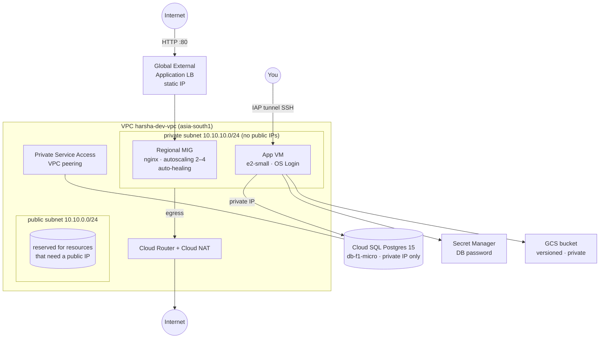
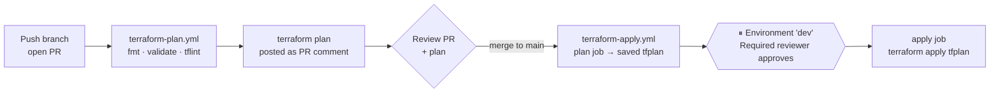

# github-terraform

GCP infrastructure for project **`newprj-harsha`**, deployed with **Terraform**, run entirely through **GitHub Actions**.
Every change is **previewed** (`terraform plan`) and only **applied** after a human approves.

---

## What gets built



| Area | Resources |
|---|---|
| **Network** | Custom VPC, public + private subnets (flow logs on private), Cloud Router, Cloud NAT, Private Service Access range + peering |
| **Firewall** | IAP-only SSH (`35.235.240.0/20`), LB/health-check ranges → port 80, internal east-west, logged deny-all |
| **Compute** | Private app VM (no external IP, Shielded VM, OS Login) |
| **Web tier** | Instance template → regional MIG (multi-zone, auto-healing, rolling updates) → autoscaler (CPU 60%) |
| **Load balancer** | Global external Application LB: static IP, backend service, URL map, HTTP proxy, forwarding rule, request logging |
| **Database** | Cloud SQL PostgreSQL 15, private IP only, SSL enforced, daily backups + PITR, Query Insights |
| **Secrets** | Random DB password stored in Secret Manager; only the app VM's SA can read it |
| **Storage** | App bucket: uniform access, public access blocked, versioning, lifecycle rules |
| **IAM** | Dedicated least-privilege service accounts for the VM and the MIG; optional IAP SSH access for named users |
| **APIs** | All required Google APIs enabled by Terraform |

---

## Repository layout

```
.
├── .github/
│   ├── actions/terraform-init/      # reusable step: OIDC auth → setup Terraform → init
│   ├── workflows/
│   │   ├── terraform-plan.yml       # PR: fmt, validate, tflint, plan → PR comment   (PREVIEW)
│   │   ├── terraform-apply.yml      # main: plan → ⏸ approval → apply saved plan     (APPLY)
│   │   └── terraform-destroy.yml    # manual: destroy plan → ⏸ approval → destroy
│   ├── CODEOWNERS
│   ├── dependabot.yml
│   └── pull_request_template.md
├── bootstrap/
│   └── bootstrap.sh                 # ONE-TIME: state bucket, CI service account, WIF
├── environments/
│   └── dev/
│       ├── backend.hcl              # state bucket + prefix for dev
│       └── terraform.tfvars         # dev settings
├── terraform/                       # root module
│   ├── versions.tf  main.tf  variables.tf  outputs.tf
│   └── modules/
│       ├── network/   # VPC, subnets, NAT, firewall, PSA
│       ├── iam/       # workload service accounts + roles
│       ├── compute/   # private VM
│       ├── mig/       # template, health check, MIG, autoscaler
│       ├── lb/        # global HTTP load balancer
│       ├── database/  # Cloud SQL + Secret Manager
│       └── storage/   # GCS bucket
└── .tflint.hcl
```

---

## How the pipeline works (preview → apply)



1. **Preview on PR** – every PR touching `terraform/` or `environments/` gets a fresh plan, posted (and updated) as a single comment.
2. **Plan again on merge** – the apply workflow re-plans against the latest state and saves the plan file as an artifact. The full plan is shown in the run summary.
3. **Approve** – the `apply` job targets the GitHub Environment `dev`, so it pauses until a reviewer clicks **Approve**.
4. **Apply exactly what was reviewed** – the job applies the saved `tfplan`. If anything changed in between, Terraform refuses the stale plan instead of applying something different.
5. If the plan has **no changes**, the apply job is skipped.

Authentication is **keyless**: GitHub's OIDC token is exchanged for short-lived GCP credentials via Workload Identity Federation. There are **no JSON keys** stored anywhere.

---

## Setup (one time, ~10 minutes)

### 1. Bootstrap GCP (run once as project Owner)

Terraform can't create the identity it runs as, so this one step happens outside the pipeline. Open **Cloud Shell** in project `newprj-harsha`:

```bash
git clone https://github.com/goshh77/github-terraform.git
cd github-terraform
./bootstrap/bootstrap.sh
```

It creates:

| Thing | Name |
|---|---|
| State bucket (versioned) | `gs://newprj-harsha-tfstate` |
| CI service account | `github-terraform-ci@newprj-harsha.iam.gserviceaccount.com` |
| Workload Identity pool / provider | `github-pool` / `github-provider` (only `goshh77/github-terraform` is trusted) |

CI service account roles: `compute.admin`, `iam.serviceAccountAdmin`, `iam.serviceAccountUser`, `resourcemanager.projectIamAdmin`, `cloudsql.admin`, `servicenetworking.networksAdmin`, `secretmanager.admin`, `storage.admin`, `serviceusage.serviceUsageAdmin`, `iap.admin`.

> If `gs://newprj-harsha-tfstate` is already taken globally, run with `STATE_BUCKET=<other-name> ./bootstrap/bootstrap.sh` and update `environments/dev/backend.hcl` to match.

### 2. Add GitHub repository variables

The script prints these at the end (and can set them for you if the `gh` CLI is logged in).
Go to **Settings → Secrets and variables → Actions → Variables** and add:

| Variable | Example value |
|---|---|
| `GCP_PROJECT_ID` | `newprj-harsha` |
| `GCP_WIF_PROVIDER` | `projects/<PROJECT_NUMBER>/locations/global/workloadIdentityPools/github-pool/providers/github-provider` |
| `GCP_SA_EMAIL` | `github-terraform-ci@newprj-harsha.iam.gserviceaccount.com` |
| `TF_STATE_BUCKET` | `newprj-harsha-tfstate` |

These are not secrets (they're identifiers), so they're stored as *variables*.

### 3. Create the approval gate

**Settings → Environments → New environment → `dev`**

- Tick **Required reviewers** and add yourself.
- (Optional) **Deployment branches** → *Selected branches* → `main`.

> Required reviewers on environments are available for **public** repos on every plan, and for **private** repos on GitHub Team/Enterprise. On a private repo with the Free plan, the apply job will run without pausing. In that case either make the repo public, or keep apply manual by removing the `push:` trigger from `terraform-apply.yml` so it only runs from **Actions → Terraform Apply → Run workflow**.

### 4. Protect `main`

**Settings → Branches → Add rule** for `main`:

- Require a pull request before merging (1 approval)
- Require status checks: **Format, validate & lint** and **Plan (dev)**

### 5. First deploy

```bash
git checkout -b feat/initial-infra
# (optional) put your email in environments/dev/terraform.tfvars → iap_ssh_members
git commit -am "Initial infrastructure" && git push -u origin feat/initial-infra
```

Open a PR → review the plan comment → merge → open the **Terraform Apply** run → review the plan in the summary → **Approve**.

The first apply takes ~15 minutes (Cloud SQL is the slow part). Outputs appear in the run summary:

```
load_balancer_url   = "http://34.x.x.x"
app_vm_ssh_command  = "gcloud compute ssh harsha-dev-app-vm --zone asia-south1-a --tunnel-through-iap ..."
db_private_ip       = "10.x.x.x"
...
```

The LB URL needs a few more minutes after apply before instances pass health checks.

---

## Everyday use

| I want to… | Do this |
|---|---|
| Change infrastructure | Edit files on a branch → PR → check plan comment → merge → approve apply |
| Re-run apply manually | **Actions → Terraform Apply → Run workflow** |
| Tear everything down | **Actions → Terraform Destroy → Run workflow**, type `DESTROY`, then approve |
| SSH to the private VM | Add yourself to `iap_ssh_members`, apply, then run the `app_vm_ssh_command` output |
| Connect to the DB from the VM | `PGPASSWORD=$(gcloud secrets versions access latest --secret=harsha-dev-pg-password) psql "host=<db_private_ip> user=appuser dbname=appdb sslmode=require"` |

### Adding another environment (e.g. prod)

1. Copy `environments/dev` → `environments/prod`, change `prefix = "env/prod"` in `backend.hcl` and values in `terraform.tfvars` (set `deletion_protection = true`, bigger `db_tier`, a different CIDR range).
2. Add `prod` to the `matrix.environment` list in `terraform-plan.yml` and to the `options` lists in the apply and destroy workflows.
3. Create a GitHub Environment `prod` with required reviewers.

---

## Cost notes (dev defaults, approximate)

Smallest sizes are used throughout: 2× `e2-micro` (MIG), 1× `e2-small` (VM), `db-f1-micro` Cloud SQL, one global LB forwarding rule and a Cloud NAT gateway. The LB forwarding rule, NAT and Cloud SQL are the main fixed costs. Run **Terraform Destroy** when you're not using the environment.

## Security notes

- No service account keys; GitHub authenticates through OIDC and only this repository is trusted.
- No VM has a public IP; SSH is through IAP only; Cloud SQL has no public IP.
- The DB password lives in Secret Manager. It also exists in Terraform **state** (and in saved plan artifacts, kept 3 days), so the state bucket is private and versioned. Restrict who can read it.
- Workload service accounts get only logging/monitoring (plus Cloud SQL client and secret access for the app VM).
